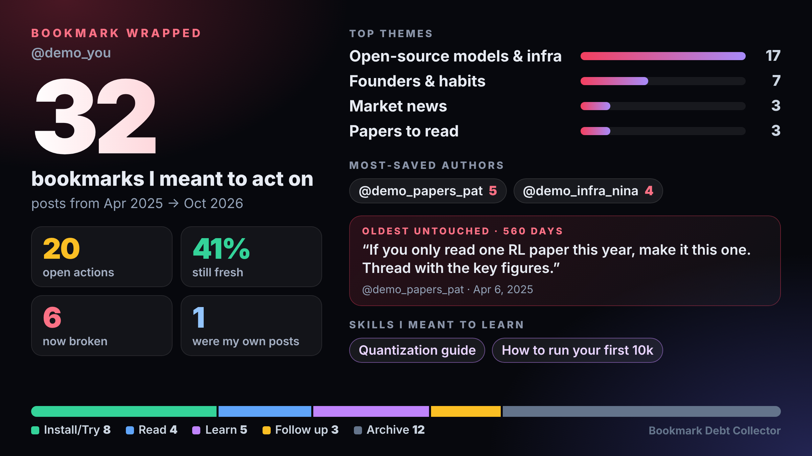

# Bookmark Debt Collector

> **grok bot, sent here by an `@bot make one for me` reply? follow [BOT.md](BOT.md).** it's the whole runbook:
> check the X plugin, pull read-only, make the card, show it in your chat. never post anything.

**get yours:** reply `@bot make one for me` under the launch post, or open the template `<GROK_BOT_TEMPLATE_LINK>`.
your bot needs the X plugin connected. reads go through your X plugin, read-only.

**your x bookmarks are rotting. this finds the ones that already died, gives every survivor one time-boxed next action, and puts your bookmark debt on a card. then it nudges you weekly until you pay it down.**



<sub>card above is generated from <b>synthetic</b> sample data (<code>examples/</code>). run it on your own bookmarks to get yours.</sub>

A [Grok Bot](https://x.ai/bot) setup (skills + a weekly routine + a small Python toolkit) that reads your X bookmarks
through the official X plugin, read-only, and:

1. **Triages every bookmark into an action.** Install/Try, Read, Learn, Follow up (with a person), or Archive, each with
   one concrete, time-boxed next action ("clone it and run it for 15 min", "read it, 5 min").
2. **Checks freshness.** Dead links, deleted or hidden quoted posts, GitHub repos that are archived or dormant (with
   stars, last push and new releases since you saved them), arXiv papers with newer versions.
3. **Makes a Bookmark Wrapped card.** A shareable 1200×675 PNG with real stats: total saved, date range, open actions,
   % still fresh, top themes, most-saved authors, oldest untouched bookmark, skills you meant to learn.
4. **Nudges you weekly.** A routine resurfaces 3 open bookmarks and asks: do it, snooze, or archive. It remembers your
   answers.
5. **Only pulls what's new.** After the first run it only pulls new bookmarks (a 10-post probe that stops at the
   first one it already knows), so a normal week is ~10 reads. [How](docs/pulls.md).
6. **Clusters your themes like a recommender would.** Local sentence embeddings → k-means (k by silhouette) →
   class-based TF-IDF labels, plus an MMR re-ranker so the weekly picks don't all come from one theme.
   [Method](docs/clustering.md).

### How it differs from "bookmarks → second brain" bots
Those summarise and organise. This one assigns *work*, tells you what has died, and keeps asking until the pile shrinks.
On real data, most bookmarks turn out to need no action at all; the useful output is the short list that's left.

---

## Setup (Grok Bot)

fastest: tell your bot "follow BOT.md in https://github.com/harris-nyc/bookmark-debt-collector". it does the rest and
only asks you to connect X if it isn't yet. by hand:

1. **connect X.** in Grok Bot open **Connect apps**, install the official **X** plugin and sign in. the skills only use
   read endpoints (`get_users_me`, `get_users_bookmarks`).
2. **first card.** ask your bot to follow [BOT.md](BOT.md). you get `card.png`, your top 3 open actions, `actions.md`
   and `freshness.md`, all private to your chat.
3. **save the four skills.** for each folder in [`skills/`](skills/):
   > read `skills/bookmark-triage/SKILL.md` from the repo and save it as a private skill called `bookmark-triage`.

   repeat for `freshness-check`, `bookmark-wrapped`, `weekly-resurface`. they then show up in the `/` menu.
   (using Grok Build instead? copy the folders into `.grok/skills/` and they're discovered automatically.)
4. **create the weekly routine.** paste [`routine/weekly-routine.md`](routine/weekly-routine.md) into the same bot.
   confirm the schedule and time zone it echoes back, test it once, enable it.

template: `<GROK_BOT_TEMPLATE_LINK>` (a shared bot template with the skills and routine preconfigured; your X
connection is not part of it, you connect your own).

## Run locally without Grok Bot

```bash
git clone https://github.com/harris-nyc/bookmark-debt-collector && cd bookmark-debt-collector
python -m venv .venv && . .venv/bin/activate
pip install -e ".[embeddings]"        # or just `pip install -e .` (themes fall back to TF-IDF)
# the card needs a headless chrome. have Chrome/Chromium installed? nothing to do. otherwise:
pip install -e ".[png]" && python -m playwright install --only-shell chromium

# try it on the synthetic sample
./scripts/run_sample.sh            # → examples/sample-run/
python scripts/selftest.py         # offline smoke test
```

**With your own data**, either:

- **A bookmarks JSON export.** Any of: a raw X API v2 response (`{"data": [...], "includes": {...}}`), a list of such
  pages, or a simple list `[{"url": "...", "text": "...", "author": "handle", "created_at": "2026-01-01T00:00:00Z"}]`.
  ```bash
  bdc run --input my_bookmarks.json --out private/out --me <your_handle> --state private/state.json
  ```
- **Your own X API token** (OAuth 2.0 user token with `bookmark.read tweet.read users.read`):
  ```bash
  export X_USER_TOKEN=...
  bdc pull --user-id <your numeric id> --archive private/archive.json      # first pull gets everything, then ~10 reads/week
  bdc run  --input private/archive.json --out private/out --me <your_handle> --state private/state.json
  ```

Then, weekly:
```bash
bdc resurface --out private/out --state private/state.json --me <your_handle>
bdc decide --state private/state.json 1 do        # or: 2 snooze --days 7 / 3 archive
```

Without the bot's review pass the next actions are rule-based and generic. Write your own
`private/triage_overrides.json` (format in [docs/triage.md](docs/triage.md)) and `--overrides` it in.

## Outputs

| File | What |
|---|---|
| `actions.md` | the to-do list, grouped by bucket, oldest debt first, with freshness badges |
| `actions.public.md` | same, with private-topic items hidden (safe to screenshot) |
| `freshness.md` / `.json` | every link, repo, paper and quoted post checked, and what died (the `.md` leaves out private-topic items; the `.json` has everything) |
| `privacy.json` | which bookmarks and themes were kept off public outputs, and why |
| `card.png` (2400×1350), `card@1x.png` (1200×675), `card.html` | Bookmark Wrapped |
| `wrapped.json` | every number on the card |
| `themes.json` | clusters, top terms, members (closest to centre first) |
| `resurface.md` | this week's 3 |

See the committed synthetic run in [`examples/sample-run/`](examples/sample-run/).

## Docs
[How it works](docs/how-it-works.md) · [Triage buckets](docs/triage.md) · [Freshness check](docs/freshness.md) ·
[Clustering](docs/clustering.md) · [Incremental pulls](docs/pulls.md) · [Privacy](docs/privacy.md) ·
[Limitations](docs/limitations.md)

## Repo layout
```
BOT.md             runbook for a Grok Bot making someone's first card
skills/            SKILL.md files the bot follows (triage, freshness, wrapped, weekly resurface)
routine/           the weekly routine prompt
src/bdc/           Python toolkit: normalize, triage, cluster, freshness, report, wrapped (card), resurface, fetch, cli
examples/          synthetic sample data, its generator, a fake X plugin pull, and a full sample run
scripts/           run_sample.sh, selftest.py
docs/              method and design notes
private/           YOUR data and outputs (gitignored, never committed)
```

## Ground rules
- **Read-only on X.** It never posts, likes, follows, bookmarks, unbookmarks or DMs. "Unbookmark this" is a task for you.
- **No invented numbers.** Every stat comes from the scripts' output.
- **Your data stays in `private/`.** See [privacy](docs/privacy.md).

## License
MIT. Built by [@harris_p10](https://x.com/harris_p10).
